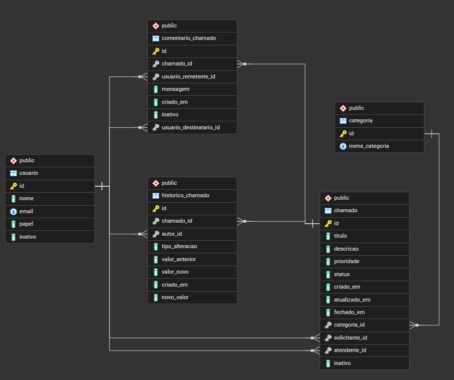

# Help Desk API

<p align="center">
  <strong>API REST para organizar o atendimento de suporte: usuários, categorias, chamados, comentários e histórico.</strong>
</p>

<p align="center">
  <a href="https://www.oracle.com/java/technologies/downloads/#java21"></a>
  <a href="https://spring.io/projects/spring-boot"></a>
  <a href="https://www.postgresql.org/"></a>
  <a href="https://opensource.org/license/mit"></a>
</p>

## Sumário

- [Visão geral](#visão-geral)
- [Funcionalidades](#funcionalidades)
- [Tecnologias](#tecnologias)
- [Pré-requisitos](#pré-requisitos)
- [Configuração e execução](#configuração-e-execução)
- [Autenticação e acesso](#autenticação-e-acesso)
- [Documentação da API](#documentação-da-api)
- [Endpoints](#endpoints)
- [Exemplos de requisição](#exemplos-de-requisição)
- [Modelo de dados](#modelo-de-dados)
- [Testes](#testes)
- [Licença](#licença)

## Visão geral

O Help Desk API oferece endpoints para registrar e acompanhar solicitações de suporte. Um chamado pode ser categorizado,
priorizado, atribuído a um atendente, comentado e acompanhado por seu histórico de alterações.

## Funcionalidades

- Cadastro, consulta, filtro, atualização de papel e inativação de usuários.
- Criação e consulta de categorias.
- Abertura, consulta, filtragem, atribuição, priorização, finalização, reabertura e exclusão de chamados.
- Comentários vinculados a chamados, com edição e exclusão.
- Histórico de alterações dos chamados.
- Validação de dados com Jakarta Bean Validation.
- Autenticação stateless por JWT nas rotas protegidas.
- Documentação interativa com Swagger UI e OpenAPI.

## Tecnologias

| Tecnologia                                                                                              | Uso                                     |
|---------------------------------------------------------------------------------------------------------|-----------------------------------------|
| [Java 21](https://www.oracle.com/java/technologies/downloads/#java21)                                   | Linguagem e plataforma                  |
| [Spring Boot 4](https://spring.io/projects/spring-boot)                                                 | Aplicação web e injeção de dependências |
| [Spring MVC](https://docs.spring.io/spring-framework/reference/web/webmvc.html)                         | API REST                                |
| [Spring Data JPA](https://spring.io/projects/spring-data-jpa) e [Hibernate](https://hibernate.org/orm/) | Persistência                            |
| [Spring Security](https://spring.io/projects/spring-security) e [JJWT](https://github.com/jwtk/jjwt)    | Segurança e JWT                         |
| [PostgreSQL](https://www.postgresql.org/)                                                               | Banco de dados                          |
| [Springdoc OpenAPI](https://springdoc.org/)                                                             | Swagger UI e especificação OpenAPI      |
| [Maven](https://maven.apache.org/)                                                                      | Build e dependências                    |

## Pré-requisitos

- JDK 21.
- Maven 3.6.3 ou superior.
- PostgreSQL em execução e um banco chamado `helpdesk`.
- Uma chave JWT com pelo menos 32 bytes.

## Configuração e execução

### 1. Prepare o banco de dados

Crie o banco `helpdesk` no PostgreSQL, por exemplo pelo `psql`:

```sql
CREATE DATABASE helpdesk;
```

A aplicação usa `jdbc:postgresql://localhost:5432/helpdesk`. Para outro endereço, ajuste `spring.datasource.url` em [
`application.yaml`](src/main/resources/application.yaml).

### 2. Configure as variáveis de ambiente

Informe usuário e senha do banco, além da chave e do tempo de expiração do JWT. `JWT_EXPIRATION` é informado em
milissegundos; o exemplo abaixo corresponde a uma hora.

PowerShell:

```powershell
$env:DATABASE_USERNAME = "seu_usuario"
$env:DATABASE_PASSWORD = "sua_senha"
$env:JWT_KEY = "cole_aqui_uma_chave_segura_com_pelo_menos_32_bytes"
$env:JWT_EXPIRATION = "3600000"
```

Linux/macOS:

```bash
export DATABASE_USERNAME="seu_usuario"
export DATABASE_PASSWORD="sua_senha"
export JWT_KEY="cole_aqui_uma_chave_segura_com_pelo_menos_32_bytes"
export JWT_EXPIRATION="3600000"
```

Gere uma chave aleatória para uso local com `openssl rand -base64 32` e use o resultado em `JWT_KEY`. Não reutilize o
texto de exemplo em produção nem armazene segredos no repositório.

### 3. Inicie a aplicação

```bash
mvn spring-boot:run
```

Por padrão, a API estará disponível em `http://localhost:8080`. O Hibernate está configurado com `ddl-auto: update` e
atualiza o esquema conforme as entidades. Essa configuração é conveniente em desenvolvimento; para produção, prefira
migrações controladas.

## Autenticação e acesso

A aplicação é stateless e espera tokens no cabeçalho `Authorization`:

```http
Authorization: Bearer <token>
```

As páginas do Swagger/OpenAPI e o cadastro `POST /v1/usuarios` não exigem autenticação. As demais rotas exigem um JWT
válido. **O projeto ainda não disponibiliza um endpoint de login ou de emissão de tokens**; o componente JWT atual
valida tokens recebidos, portanto o token precisa ser obtido por um fluxo externo enquanto essa funcionalidade não é
implementada.

Os papéis disponíveis são `COLABORADOR`, `ATENDENTE` e `ADMINISTRADOR`. O cadastro atual recebe nome, e-mail e papel,
mas não recebe senha; assim, o cadastro por si só não configura credenciais para autenticação.

## Documentação da API

Com a aplicação em execução:

- [Swagger UI](http://localhost:8080/swagger-ui/index.html) — explore e teste os endpoints.
- [OpenAPI JSON](http://localhost:8080/v3/api-docs) — especificação da API.

O prefixo das rotas é `/v1`. Os endpoints detalhados também estão implementados
nos [controllers](src/main/java/com/controller/).

## Endpoints

As respostas de sucesso usam JSON, exceto quando indicado. Os parâmetros de filtro são opcionais, salvo indicação
contrária.

### Usuários — `/v1/usuarios`

| Método   | Rota                              | Descrição                                                  |
|----------|-----------------------------------|------------------------------------------------------------|
| `GET`    | `/v1/usuarios?letra=A`            | Lista usuários ativos; `letra` filtra pela inicial do nome |
| `GET`    | `/v1/usuarios/{id}`               | Busca usuário por ID                                       |
| `GET`    | `/v1/usuarios/{email}/email`      | Busca usuário por e-mail                                   |
| `POST`   | `/v1/usuarios`                    | Cadastra usuário                                           |
| `PATCH`  | `/v1/usuarios/{id}/{papel}/papel` | Altera o papel do usuário                                  |
| `DELETE` | `/v1/usuarios/{email}/delete`     | Inativa usuário                                            |

### Categorias — `/v1/categorias`

| Método   | Rota                                 | Descrição              |
|----------|--------------------------------------|------------------------|
| `GET`    | `/v1/categorias`                     | Lista categorias       |
| `GET`    | `/v1/categorias/{id}`                | Busca categoria por ID |
| `POST`   | `/v1/categorias/{nomeCategoria}/add` | Cria categoria         |
| `DELETE` | `/v1/categorias/{id}/delete`         | Exclui categoria       |

### Chamados — `/v1/chamados`

| Método   | Rota                                                 | Descrição                                                                                 |
|----------|------------------------------------------------------|-------------------------------------------------------------------------------------------|
| `GET`    | `/v1/chamados`                                       | Lista chamados; filtros: `status`, `prioridade`, `idCategoria` e `idSolicitante`          |
| `POST`   | `/v1/chamados`                                       | Cria chamado                                                                              |
| `GET`    | `/v1/chamados/{id_chamado}`                          | Busca chamado por ID                                                                      |
| `GET`    | `/v1/chamados/{id_chamado}/historico`                | Consulta histórico do chamado                                                             |
| `PATCH`  | `/v1/chamados/{id_chamado}/atendente/{id_atendente}` | Atribui atendente; também exige `id_chamado` e `id_atendente` como parâmetros de consulta |
| `PATCH`  | `/v1/chamados/{id_chamado}/{prioridade}/prioridade`  | Altera prioridade                                                                         |
| `PATCH`  | `/v1/chamados/status?novoStatus={status}`            | Altera status; também aceita `idChamado` ou `nomeChamado`                                 |
| `PATCH`  | `/v1/chamados/{id}`                                  | Finaliza chamado                                                                          |
| `PATCH`  | `/v1/chamados/{id}/reabrir`                          | Reabre chamado                                                                            |
| `DELETE` | `/v1/chamados/{id}/delete`                           | Exclui chamado                                                                            |

Valores de status: `ABERTO`, `EM_ANDAMENTO`, `FINALIZADO`. Valores de prioridade: `ALTA`, `MEDIA`, `BAIXA`.

### Comentários — `/v1/comentarios`

| Método   | Rota                                  | Descrição                   |
|----------|---------------------------------------|-----------------------------|
| `GET`    | `/v1/comentarios`                     | Lista comentários           |
| `POST`   | `/v1/comentarios/{chamadoId}/chamado` | Cria comentário no chamado  |
| `PATCH`  | `/v1/comentarios/{idComentario}`      | Atualiza a mensagem         |
| `DELETE` | `/v1/comentarios/{idComentario}`      | Exclui comentário           |
| `DELETE` | `/v1/comentarios`                     | Exclui todos os comentários |

## Exemplos de requisição

### Cadastrar usuário

```bash
curl -X POST http://localhost:8080/v1/usuarios \
  -H "Content-Type: application/json" \
  -d '{
    "nome": "Ana Souza",
    "email": "ana@example.com",
    "papel": "colaborador"
  }'
```

### Criar chamado

```bash
curl -X POST http://localhost:8080/v1/chamados \
  -H "Content-Type: application/json" \
  -H "Authorization: Bearer <token>" \
  -d '{
    "titulo": "Acesso ao sistema",
    "descricao": "Não consigo acessar minha conta.",
    "prioridade": "MEDIA",
    "status": "ABERTO",
    "idCategoria": 1,
    "idSolicitante": 1,
    "idAtendente": 2
  }'
```

## Modelo de dados



Um chamado pertence a uma categoria e referencia solicitante e atendente. Também pode ter comentários e registros de
histórico; cada comentário referencia os usuários remetente e destinatário.

## Testes

Com o PostgreSQL disponível e as variáveis de ambiente configuradas, execute:

```bash
mvn test
```

## Licença

Distribuído sob a licença [MIT](LICENSE).
